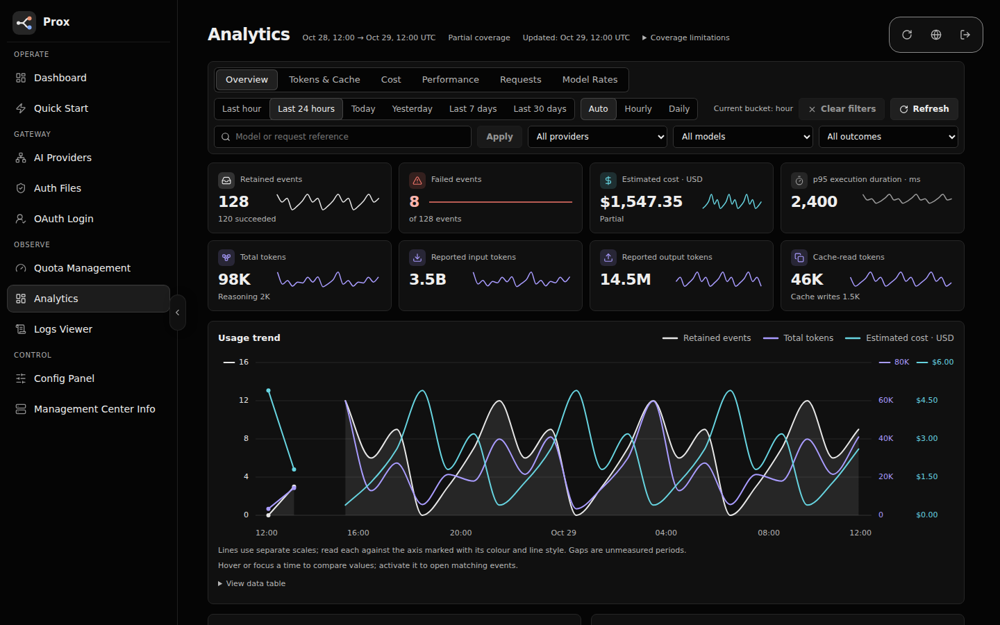
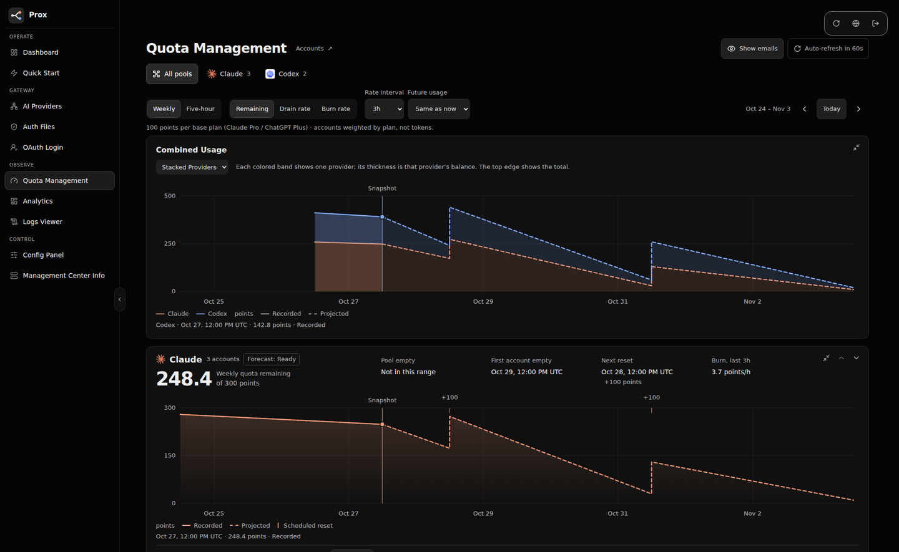
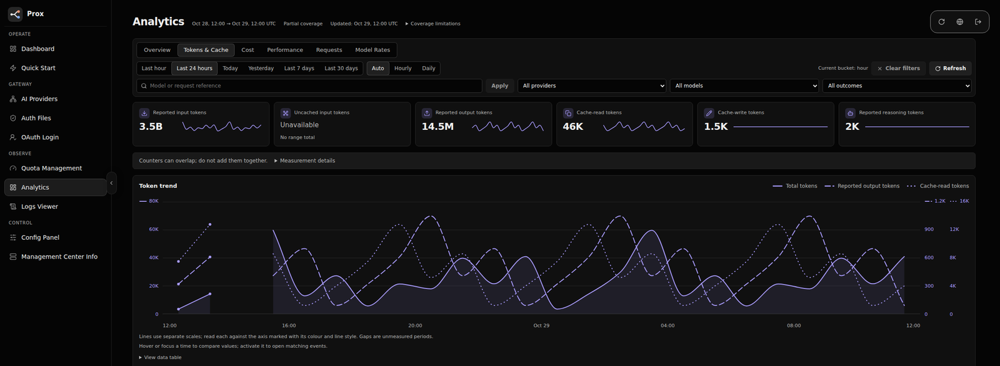
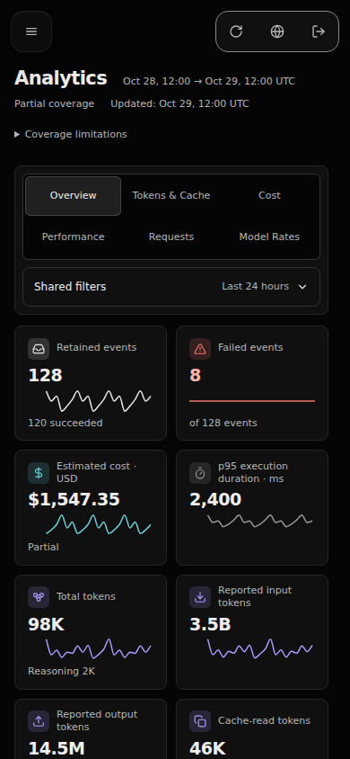
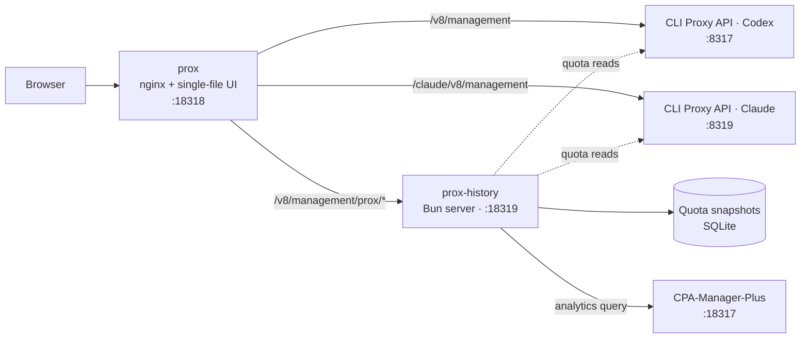

<div align="center">


# Prox

**One console for every CLI Proxy API instance you run.**

Pooled quota forecasts, usage analytics and every management page for your Claude and Codex runtimes — in a single HTML file.

[](https://github.com/router-for-me/CLIProxyAPI)
[](#build-and-deploy)
[](LICENSE)
[](https://github.com/router-for-me/Cli-Proxy-API-Management-Center)

**English** · [简体中文](README_CN.md)

[What Prox adds](#what-prox-adds) · [Screenshots](#screenshots) · [How it fits together](#how-it-fits-together) · [Build and deploy](#build-and-deploy) · [Development](#development)

</div>

---

Prox is a fork of [CLI Proxy API Management Center](https://github.com/router-for-me/Cli-Proxy-API-Management-Center). It keeps the upstream management pages and adds what you need when one homelab runs several CLI Proxy API instances: a quota pool across every Claude and Codex account, retained-usage analytics, and one login that reaches each instance through its own management source.

> [!IMPORTANT]
> Requires **CLI Proxy API ≥ 8.0.0** (v8 Management API, `/v8/management`). Prox is a management UI; it never forwards inference traffic. Analytics additionally needs a [CPA-Manager-Plus](https://github.com/SwiggitySwerve/CPA-Manager-Plus) usage dataset.

## What Prox adds

| Area | What you get |
| --- | --- |
| **Quota Management** | One pool across all Claude and Codex accounts, in points weighted by plan (100 points = one base plan, such as Claude Pro or ChatGPT Plus). Recorded history and projected balances with scheduled resets, weekly and five-hour windows, remaining, drain and burn views, per-account windows, and a visible 60-second auto-refresh. |
| **Analytics** | Retained usage across your instances: cards with sparklines, a trend chart of requests, tokens and cost on separate scales, provider and model breakdowns, a request log with details, and the configured model rates. Tabs for Overview, Tokens & Cache, Cost, Performance, Requests and Model Rates. |
| **Fast, shareable views** | Pill selectors for the time range (Last hour, 24 hours, Today, Yesterday, 7 or 30 days) and bucket size (Auto, Hourly, Daily). The address carries the view — `#/analytics?tab=tokens&range=7d&bucket=hour` — so a link opens it directly, and the last view and sidebar state are remembered on this browser. A 7-day view loads in well under a second. |
| **Fits your screen** | The first chart is fully visible on load at every desktop size from 1024 to 3440 pixels wide, sidebar open or collapsed; browser tests enforce it. Phones get stacked cards and collapsible filters. |
| **Honest numbers** | Prox shows what the backends report. Costs are API-equivalent estimates at your configured rates (cache writes priced at the cache-write rate, matching the CPA-Manager-Plus dashboard), labelled *Partial* when a component is unknown. Quiet hours draw as zero; unmeasured periods stay gaps. |
| **Several runtimes, one login** | A checked-in manifest (`deploy/provider-sources.json`) lists each instance. Account, log and config pages target the selected **Management source**; pooled pages read them all. |

It keeps everything from upstream: dashboard, visual and YAML configuration, AI providers, auth files and OAuth, per-provider quotas, logs, plugins and system information. The UI speaks **English, 简体中文, 繁體中文, Русский, 한국어 and Tiếng Việt**.

## Screenshots

All screenshots use the synthetic test fixtures, never real accounts or keys.

<p align="center">
  
</p>

<p align="center"><sub><b>Analytics</b> — cards, the usage trend and filters, with the whole first chart on screen at 1440×900.</sub></p>

<p align="center">
  
</p>

<p align="center"><sub><b>Quota Management</b> — combined Claude and Codex pools, recorded history and projected resets.</sub></p>

<table>
  <tr>
    <td width="72%"></td>
    <td></td>
  </tr>
  <tr>
    <td align="center"><sub>Tokens & Cache on a 3440×1440 screen at 150% scaling</sub></td>
    <td align="center"><sub>Phone</sub></td>
  </tr>
</table>

## How it fits together



- **`prox`** serves the UI and routes each management source to its instance. The browser sends the management key; nginx never injects one.
- **`prox-history`** records quota snapshots for the pooled forecasts and forwards bounded analytics queries to CPA-Manager-Plus, which owns token accounting, pricing and latency figures.
- Keys live in server-only files mounted into the containers. None are in Git or the bundle.

## Build and deploy

Use **Bun 1.4.3** (pinned in `package.json`):

```bash
bun install --frozen-lockfile
bun run build
```

This produces **`dist/index.html`** (the whole UI, JavaScript and CSS inlined) and **`dist/server.js`** (the `prox-history` server). The build also checks that the generated nginx routes and public source list match `deploy/provider-sources.json`; run `bun run sources:generate` after editing the manifest.

For the homelab setup — rootless Podman user services, ports, routing, Authentik and how to connect each runtime — see [docs/PROX-SETUP.md](docs/PROX-SETUP.md). Provider ownership and credential recovery are in [docs/PROVIDER-OWNERSHIP.md](docs/PROVIDER-OWNERSHIP.md).

<details>
<summary><strong>Using it as a plain Management Center</strong></summary>

`dist/index.html` also works on its own, like the upstream `management.html`: host it, open it, and enter your instance's address and **management key**. Pages that need `prox-history` (pooled quotas, Analytics) report that they are unavailable instead of failing silently.

</details>

## Development

```bash
bun install --frozen-lockfile
bun run dev
```

Open `http://localhost:5173` and connect to a backend.

**Built with** React 19 · TypeScript 6 · Vite 8 · Bun · Zustand · React Router 7 · Motion · CodeMirror 6 · SCSS Modules · i18next.

| Command | Purpose |
| --- | --- |
| `bun run dev` | Start the Vite dev server |
| `bun run build` | Type-check, build the UI and the history server |
| `bun run test` | Run the Bun unit tests |
| `bun run lint` | Run ESLint; warnings are not failures |
| `bun run verify` | Tests, lint and build — run before every PR |
| `bun run test:ui:analytics` | Playwright browser suite: Analytics behaviour, layouts at 16 window sizes, touch targets |
| `bun run sources:generate` | Regenerate nginx routes and public discovery from the source manifest |

Visual reviews use repeatable capture scripts in `scripts/visual/` with measured contrast, target-size and overflow checks; results live under `docs/evidence/`. See [AGENTS.md](AGENTS.md) for repository conventions.

## Security

- Treat the management key as a secret. **Remember password** stores it in browser storage with reversible obfuscation — **not encryption**. Use a trusted device or a dedicated browser profile.
- The analytics grant reads the whole configured usage dataset; it is meant for a single-administrator homelab, not shared or tenant access.
- Expose Prox publicly only behind an authentication gate (the homelab uses Authentik) in addition to the management key.

## Troubleshooting

<details>
<summary><strong>Connection, quotas or analytics unavailable</strong></summary>

- **Cannot connect / 401:** check the address and management key. Remote connections may require `management.allow-remote: true` on the instance.
- **Pooled quotas or Analytics unavailable:** check `systemctl --user status prox-history`. Analytics also needs CPA-Manager-Plus reachable from it.
- **Model list unavailable:** `/v1/models` needs at least one client API key in `access.api-keys`.
- **Logs page missing:** enable “Logging to file” in Basic Settings.

</details>

---

<div align="center">

Fork of [CLI Proxy API Management Center](https://github.com/router-for-me/Cli-Proxy-API-Management-Center) by Router-For.ME · [CLI Proxy API](https://github.com/router-for-me/CLIProxyAPI) · [Report an issue](https://github.com/SwiggitySwerve/prox/issues) · [MIT License](LICENSE)

</div>
