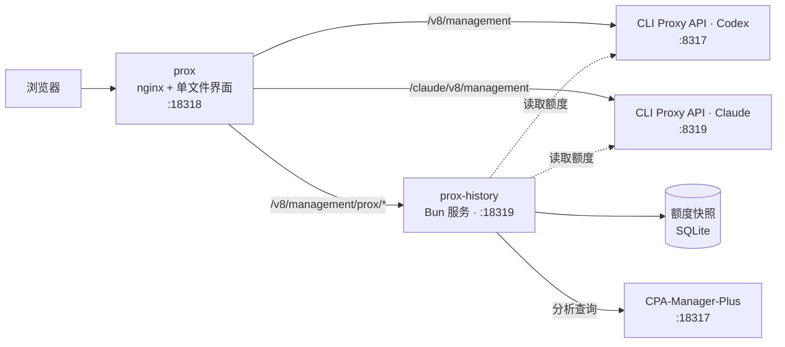

<div align="center">


# Prox

**一个控制台，管理你运行的所有 CLI Proxy API 实例。**

为 Claude 与 Codex 运行时提供合并额度预测、用量分析和全部管理页面——只需一个 HTML 文件。

[](https://github.com/router-for-me/CLIProxyAPI)
[](#构建与部署)
[](LICENSE)
[](https://github.com/router-for-me/Cli-Proxy-API-Management-Center)

[English](README.md) · **简体中文**

[Prox 新增功能](#prox-新增功能) · [截图](#截图) · [整体架构](#整体架构) · [构建与部署](#构建与部署) · [开发](#开发)

</div>

---

Prox 是 [CLI Proxy API Management Center](https://github.com/router-for-me/Cli-Proxy-API-Management-Center) 的分支。它保留上游的全部管理页面，并补充了在一个家庭实验室中运行多个 CLI Proxy API 实例时所需的功能：覆盖所有 Claude 与 Codex 账号的额度池、已保留用量的分析，以及通过各自管理源访问每个实例的统一登录。

> [!IMPORTANT]
> 需要 **CLI Proxy API ≥ 8.0.0**（v8 管理 API，`/v8/management`）。Prox 是管理界面，从不转发推理流量。分析功能还需要 [CPA-Manager-Plus](https://github.com/SwiggitySwerve/CPA-Manager-Plus) 用量数据集。

## Prox 新增功能

| 模块 | 功能 |
| --- | --- |
| **额度管理** | 将所有 Claude 与 Codex 账号合并为一个额度池，按套餐加权计点（100 点 = 一个基础套餐，例如 Claude Pro 或 ChatGPT Plus）。显示历史记录与包含计划重置的预测余量，支持每周与五小时窗口、剩余/消耗/燃烧视图、单账号窗口，以及可见的 60 秒自动刷新。 |
| **用量分析** | 汇总各实例的已保留用量：带迷你走势图的指标卡、按独立刻度绘制请求数/Token/成本的趋势图、按提供商与模型的分解、带详情的请求记录以及已配置的模型价格。分为概览、Token 与缓存、成本、性能、请求、模型价格六个标签页。 |
| **快速、可分享的视图** | 用胶囊按钮选择时间范围（最近 1 小时、24 小时、今天、昨天、7 天、30 天）与分桶粒度（自动、按小时、按天）。地址栏保存当前视图——例如 `#/analytics?tab=tokens&range=7d&bucket=hour`——链接可直接打开该视图；本浏览器还会记住上次的视图与侧边栏状态。7 天视图的加载时间远低于一秒。 |
| **适配屏幕** | 从 1024 到 3440 像素宽的各种桌面尺寸下（侧边栏展开或收起），首个图表在加载时完整可见，并由浏览器测试保证。手机上卡片堆叠显示，筛选项可折叠。 |
| **如实的数据** | Prox 只显示后端报告的数值。成本是按已配置价格估算的 API 等价金额（缓存写入按缓存写入价格计费，与 CPA-Manager-Plus 仪表盘一致），存在未知成分时标记为 *部分*。空闲时段绘制为零，未测量时段保持空缺。 |
| **多个运行时，一次登录** | 仓库中的清单（`deploy/provider-sources.json`）列出每个实例。账号、日志与配置页面作用于所选的 **管理源**；合并页面读取全部实例。 |

上游的全部功能均已保留：仪表盘、可视化与 YAML 配置、AI 提供商、认证文件与 OAuth、各提供商额度、日志、插件以及系统信息。界面支持 **English、简体中文、繁體中文、Русский、한국어 与 Tiếng Việt**。

## 截图

所有截图均使用合成测试数据，绝不包含真实账号或密钥。

<p align="center">
  
</p>

<p align="center"><sub><b>用量分析</b>——指标卡、用量趋势与筛选项；在 1440×900 下首个图表完整可见。</sub></p>

<p align="center">
  
</p>

<p align="center"><sub><b>额度管理</b>——合并的 Claude 与 Codex 额度池、历史记录与预测重置。</sub></p>

<table>
  <tr>
    <td width="72%"></td>
    <td></td>
  </tr>
  <tr>
    <td align="center"><sub>150% 缩放的 3440×1440 屏幕上的 Token 与缓存</sub></td>
    <td align="center"><sub>手机</sub></td>
  </tr>
</table>

## 整体架构



- **`prox`** 提供界面，并把每个管理源路由到对应实例。管理密钥由浏览器发送；nginx 从不注入密钥。
- **`prox-history`** 记录额度快照用于合并预测，并把受限的分析查询转发给 CPA-Manager-Plus；Token 统计、定价与延迟数据由后者负责。
- 密钥保存在挂载进容器的仅服务器可读文件中，从不进入 Git 或打包产物。

## 构建与部署

使用 **Bun 1.4.3**（已在 `package.json` 中固定）：

```bash
bun install --frozen-lockfile
bun run build
```

构建产物为 **`dist/index.html`**（完整界面，JavaScript 与 CSS 均已内联）和 **`dist/server.js`**（`prox-history` 服务）。构建还会检查生成的 nginx 路由与公开源列表是否与 `deploy/provider-sources.json` 一致；修改清单后请运行 `bun run sources:generate`。

家庭实验室部署——无根 Podman 用户服务、端口、路由、Authentik 以及如何连接各运行时——请参见 [docs/PROX-SETUP.md](docs/PROX-SETUP.md)。提供商归属与凭据恢复请参见 [docs/PROVIDER-OWNERSHIP.md](docs/PROVIDER-OWNERSHIP.md)。

<details>
<summary><strong>作为普通 Management Center 使用</strong></summary>

`dist/index.html` 也可以像上游的 `management.html` 一样单独使用：部署后打开页面，输入实例地址和 **管理密钥** 即可。需要 `prox-history` 的页面（合并额度、用量分析）会提示不可用，而不是静默失败。

</details>

## 开发

```bash
bun install --frozen-lockfile
bun run dev
```

打开 `http://localhost:5173` 并连接后端。

**技术栈** React 19 · TypeScript 6 · Vite 8 · Bun · Zustand · React Router 7 · Motion · CodeMirror 6 · SCSS Modules · i18next。

| 命令 | 用途 |
| --- | --- |
| `bun run dev` | 启动 Vite 开发服务器 |
| `bun run build` | 类型检查，构建界面与 history 服务 |
| `bun run test` | 运行 Bun 单元测试 |
| `bun run lint` | 运行 ESLint；警告不视为失败 |
| `bun run verify` | 测试、Lint 与构建——每个 PR 前运行 |
| `bun run test:ui:analytics` | Playwright 浏览器测试：分析功能行为、16 种窗口尺寸的布局、触控目标 |
| `bun run sources:generate` | 根据源清单重新生成 nginx 路由与公开发现文件 |

视觉评审使用 `scripts/visual/` 中可重复运行的截图脚本，并测量对比度、目标尺寸与溢出；结果保存在 `docs/evidence/`。仓库约定请参见 [AGENTS.md](AGENTS.md)。

## 安全

- 请将管理密钥视为机密。启用 **记住密码** 后，密钥会以可逆混淆方式保存在浏览器存储中——**并非加密**。请使用可信设备或专用浏览器配置文件。
- 分析授权可读取完整的已配置用量数据集；它面向单管理员的家庭实验室，不适用于共享或多租户访问。
- 公开暴露 Prox 时，除管理密钥外还应放在认证网关之后（家庭实验室使用 Authentik）。

## 故障排查

<details>
<summary><strong>无法连接、额度或分析不可用</strong></summary>

- **无法连接 / 401：** 检查地址与管理密钥。远程连接可能需要在实例上设置 `management.allow-remote: true`。
- **合并额度或用量分析不可用：** 检查 `systemctl --user status prox-history`。用量分析还需要该服务能够访问 CPA-Manager-Plus。
- **模型列表不可用：** `/v1/models` 需要 `access.api-keys` 中至少有一个客户端 API 密钥。
- **日志页面缺失：** 在基础设置中启用“记录日志到文件”。

</details>

---

<div align="center">

[CLI Proxy API Management Center](https://github.com/router-for-me/Cli-Proxy-API-Management-Center)（Router-For.ME）的分支 · [CLI Proxy API](https://github.com/router-for-me/CLIProxyAPI) · [报告问题](https://github.com/SwiggitySwerve/prox/issues) · [MIT 许可证](LICENSE)

</div>
