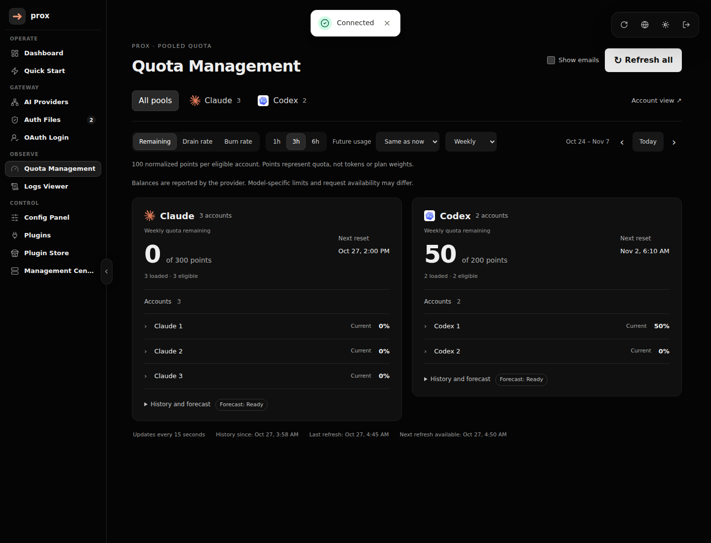
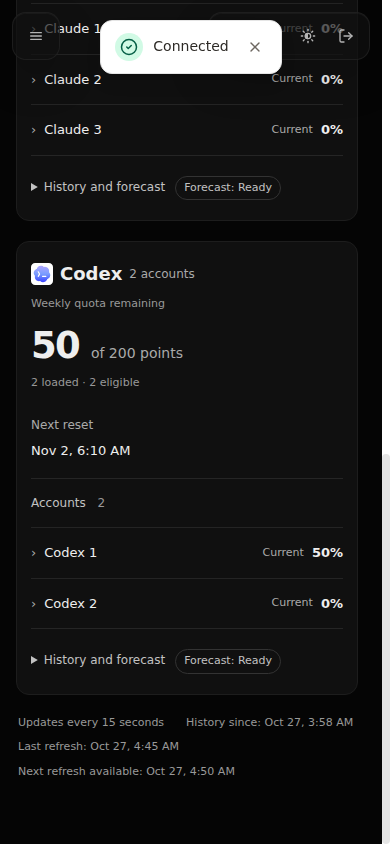

# Account-first quota verification

Verified on 2026-10-27 against the deployed quota page.

- Both provider summaries and all five authenticated account rows are visible by default on desktop. Charts and forecast statistics expand separately.
- Weekly and five-hour filters, provider filters, scenario controls, email reveal/hide, and manual refresh worked. Refresh returned the documented HTTP 202 response.
- Desktop (1440px), mobile (390px), and wide (1853px) checks found no horizontal page overflow, JavaScript errors, or HTTP failures. Private account identities remained hidden unless explicitly revealed.
- Inspected both provider cards on mobile and the expanded charts on desktop.
- All 1,722 tests, lint, TypeScript checks, and production builds passed. The two new display regression cases failed against the prior implementation.
- Four live inference tests returned `PROXY_OK`: Claude Sonnet and Opus, GPT Sol and Astra. Both streaming tests completed without error events. Only the Prox UI service restarted; inference services and credential data were preserved.

Provider-reported balances are separate from forecast readiness and actual request availability. Claude accepted requests despite reporting zero general weekly balance, which is why no new routing-availability inference is made from this page.

